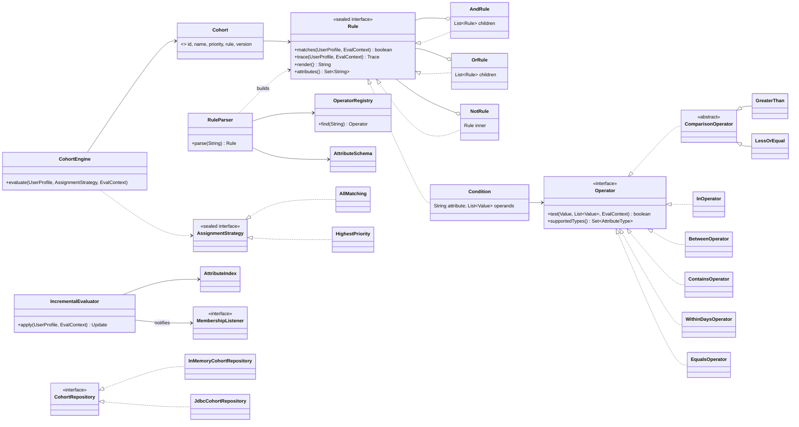

# Cohort: a user segmentation engine in Java

Define customer cohorts as rules, assign users to them, and explain why.

```
orders_90d >= 6 AND days_since_last_order BETWEEN 15 AND 60        -- "at-risk regular"
```

```
[at-risk-regular] priority 90 v1
  ✓ AND
    ✓ orders_90d >= 6                          (actual: 7)
    ✓ days_since_last_order BETWEEN 15 AND 60  (actual: 18)
```

The domain is quick-commerce grocery. Raw orders become derived attributes (recency, frequency, spend,
category mix). Rules over those attributes define lifecycle stages (new, at-risk, churned), RFM-style
segments, category affinity ("daily dairy") and upgrade candidates.

- **`cohort-core`**: plain Java 21, no framework. Rule language, parser, engine, incremental index, parallel
  bulk scoring, in-memory and JDBC repositories.
- **`cohort-api`**: a thin Spring Boot 4 REST layer over the core.

## Results (100,000 synthetic customers, 1.65M orders, 14 cohorts)

| What | Result |
|---|---|
| Bulk scoring, orders → attributes → all cohorts, 1 thread | 327 ms (306k users/s) |
| Same, on a fixed thread pool | 108 ms, **3.0× faster** (921k users/s) |
| Overnight refresh: rule evaluations needed with the attribute index | **42.6% fewer** than a full re-score (0.80M vs 1.40M) |
| Intraday new orders: rule evaluations needed | 17.8% fewer (an order touches most attributes) |
| Correctness | Incremental membership verified identical to a full re-score for all 100k users; multi-threaded assignments identical to single-threaded |

Measured on an i5-12450H laptop (4 performance + 4 efficiency cores, 12 threads), Java 26, default JVM
settings, median of 7 runs after 3 warm-ups. Speed-up flattens after 4 threads: that's the number of
performance cores, and attribute computation allocates heavily, so it runs into memory bandwidth and GC.
Reproduce with:

```
./mvnw -q -pl cohort-core -am install -DskipTests
java -cp cohort-core/target/classes dev.snehil.cohort.bench.Benchmark          # or pass a user count
```

## Quick start

```bash
./mvnw verify                                   # 110 tests; JDBC tests run when COHORT_TEST_JDBC_URL is set
java -jar cohort-api/target/cohort-api-0.1.0-SNAPSHOT.jar   # in-memory storage, 14 default cohorts, port 8080
```

```bash
# Create a cohort (the rule is parsed and type-checked)
curl -XPOST localhost:8080/cohorts -H 'content-type: application/json' \
  -d '{"name": "Weekly buyer going quiet", "priority": 50,
       "rule": "orders_30d >= 4 AND days_since_last_order > 14"}'

# A bad rule gets a 400 that points at the mistake
curl -XPOST localhost:8080/rules/validate -H 'content-type: application/json' \
  -d '{"rule": "orders_30d >= 4 AND days_since_last_ordr > 14"}'
#  "pointer": "orders_30d >= 4 AND days_since_last_ordr > 14
#                                  ^ unknown attribute 'days_since_last_ordr' (did you mean 'days_since_last_order'?)"

# Evaluate a user from raw orders (mode=all or mode=priority; asOf is optional)
curl -XPOST 'localhost:8080/users/asha/evaluate?asOf=2026-11-01' -H 'content-type: application/json' \
  -d '{"city": "bengaluru", "orders": [
        {"date": "2026-10-14", "amountPaisa": 50000, "categories": ["dairy", "produce"]},
        {"date": "2026-10-07", "amountPaisa": 47000, "categories": ["dairy"]}]}'

curl localhost:8080/users/asha/cohorts          # stored result of the last evaluation
```

With PostgreSQL:

```bash
docker compose up -d
COHORT_DB_URL=jdbc:postgresql://localhost:5434/cohort \
  java -jar cohort-api/target/cohort-api-0.1.0-SNAPSHOT.jar --spring.profiles.active=postgres
```

| Endpoint | |
|---|---|
| `POST /cohorts` | create, or replace by id (version + 1) |
| `GET /cohorts`, `GET /cohorts/{id}`, `DELETE /cohorts/{id}` | catalog |
| `POST /rules/validate` | parse and type-check without saving |
| `POST /users/{id}/evaluate?mode=all\|priority&asOf=` | build the profile, assign, explain, store |
| `GET /users/{id}/cohorts` | last stored assignment |

## The rule language

```
rule      := or
or        := and ( OR and )*
and       := not ( AND not )*
not       := NOT not | primary
primary   := '(' or ')' | condition
condition := attribute operator operands
```

`NOT` binds tighter than `AND`, which binds tighter than `OR`. Keywords are case-insensitive.

| Operator | Applies to | Example |
|---|---|---|
| `=` `!=` | number, boolean, text, date | `bought_premium = false` |
| `>` `>=` `<` `<=` | number, date | `spend_90d >= 5000` |
| `BETWEEN a AND b` | number, date (inclusive) | `days_since_last_order BETWEEN 15 AND 60` |
| `IN (...)` | number, text | `city IN ('bengaluru', 'hyderabad')` |
| `CONTAINS` | text set (membership), text (substring) | `categories_30d CONTAINS 'dairy'` |
| `WITHIN_DAYS n` | date (time-dependent) | `first_order_date WITHIN_DAYS 14` |

Attributes (from `OrderStatsCalculator`): `city`, `signup_date`, `first_order_date`, `last_order_date`,
`first_order_week`, `days_since_last_order`, `orders_7d/30d/90d/total`, `spend_30d/90d` (rupees),
`avg_order_value_90d`, `active_weeks_8w`, `bought_premium`, `categories_30d`, and
`<category>_orders_30d` for dairy, produce, bakery, staples, meat, snacks, beverages, personal_care.
The default catalog is in [`default-cohorts.txt`](cohort-core/src/main/resources/default-cohorts.txt).

## Design



| Package | Responsibility | Patterns |
|---|---|---|
| `domain` | `UserProfile`, `Order`, `Customer`, `Cohort`, typed `Value` (sealed) | immutable records, validation in constructors |
| `stats` | orders → derived attributes, plus the attribute schema | stateless, so thread-safe |
| `rule` | the rule tree: `AndRule`, `OrRule`, `NotRule`, `Condition`, explanation `Trace` | **Composite**, sealed hierarchy |
| `rule.op` | operators and their registry | **Strategy**, **Template Method** (`ComparisonOperator`) |
| `parse` | hand-written lexer and recursive-descent parser with type checking | **Interpreter** |
| `engine` | `CohortEngine`, assignment modes | **Strategy**, immutable snapshot |
| `index` | attribute → cohort index, incremental re-evaluation, membership events | **Observer** |
| `bulk` | parallel scoring on an `ExecutorService` | share-nothing partitioning |
| `repo` | `CohortRepository`, `MembershipRepository`: in-memory and JDBC | **Repository**, dependency inversion |

## Decisions

**Sealed `Rule` with four node kinds; open `Operator` interface.** The tree shape (and/or/not/leaf) is
fixed, so it's sealed: `switch` over a `Rule` is exhaustive with no `default`, and adding a node kind would
break the build everywhere it isn't handled (see `Rules`). The comparisons are where change happens, so
operators are an open interface behind a registry. A new keyword operator needs no lexer, parser,
`Condition` or engine change (`OperatorTest.registryIsOpenForNewOperators`).

**Composition over inheritance, with one exception.** Rules contain rules, and conditions contain
operators. The only class inheritance is `ComparisonOperator`: `>`, `>=`, `<` and `<=` really are one
algorithm that differs in one predicate.

**A hand-written recursive-descent parser instead of a parser generator.** The grammar is small, and each
precedence level is one method, so `a OR b AND c` → `a OR (b AND c)` falls out of the call structure.
Hand-writing it keeps exact token positions for errors and handles `BETWEEN 1 AND 5` (the inner `AND` is
consumed by the condition before the and-level sees it). Nesting depth is capped at 64, so hostile input gets a
parse error instead of a `StackOverflowError`.

**Type-check rules when they're saved, not when they run.** The parser checks every attribute against the
schema (with "did you mean"), every operator against the attribute's type, and coerces date literals. A
broken cohort is rejected by `POST /cohorts`, not discovered by a 3 a.m. batch job.

**A missing attribute never matches.** A user with no orders has no `days_since_last_order`, so both
`> 14` and `<= 14` are false (and `NOT (> 14)` is true), like SQL's NULL. The trace shows "missing".

**Money as `long` paisa.** It's never a floating-point number. Rules use whole rupees for readability.

**The engine is an immutable snapshot.** A catalog change builds a new `CohortEngine` and swaps it in through an
`AtomicReference`. Evaluations in flight keep the old snapshot, and readers never lock.

**Why incremental re-evaluation is correct.** A rule's result depends only on the attributes it reads,
plus the date for time-dependent operators (`WITHIN_DAYS`). So when a profile changes, only cohorts that read
a changed attribute can change answer. When the date moves on, the time-dependent cohorts are added too.
This is verified two ways: by a randomized test (3,000 random updates, orders and day jumps, compared
against a full re-score after every step; removing the date check makes it fail), and by the benchmark
over all 100k users.

**Why the intraday saving is only 18%.** A new order changes recency, all the frequency and spend
windows, and category counts, so most cohorts read something that changed. The index pays off when changes
are narrow: the overnight refresh (mostly only recency ages) saves 43%, and a city change re-checks 1 of 14
cohorts. A finer index on *thresholds* (orders_30d going 5 → 6 can't affect `orders_30d >= 8`) would
save more. That's the next step, not done here.

**Bulk scoring shares nothing.** Each task owns a contiguous chunk, its own counters and its own slice of
the output array, so there are no locks or atomics on the hot path. Results are merged after
`Future.get()`, which also publishes the workers' writes. The single-threaded baseline uses the same
chunking on the caller's thread, so the comparison is fair. An earlier version without chunking showed
a misleading super-linear "3.2× on 2 threads".

**Repositories behind interfaces.** The API depends on `CohortRepository`, not on Postgres. One abstract
contract test (`RepositoryContract`) runs against both implementations, including a concurrent-save test
for version numbers. The JDBC save is a single `INSERT … ON CONFLICT DO UPDATE … RETURNING version`, so the
bump is atomic in the database, with no read-modify-write race.

**Deliberately out of scope:** Kafka, a distributed deployment, a UI, ML-based clustering, Drools.

## Tests

110 tests (JUnit 5, AssertJ, Spring MockMvc):

- **Operators:** parameterized against a known profile.
- **Parser:** precedence, flattening, round trips (`parse(render(r)) == r`), and 16 malformed rules, each
  checked for the exact error position.
- **Engine:** short-circuit evaluation, explanation traces, attribute-window boundaries.
- **Incremental evaluator:** randomized equivalence against a full re-score.
- **Bulk scoring:** parallel results equal sequential.
- **Repositories:** one contract run against both in-memory and PostgreSQL.
- **API:** REST tests.

CI (GitHub Actions) runs everything against a PostgreSQL service container.
